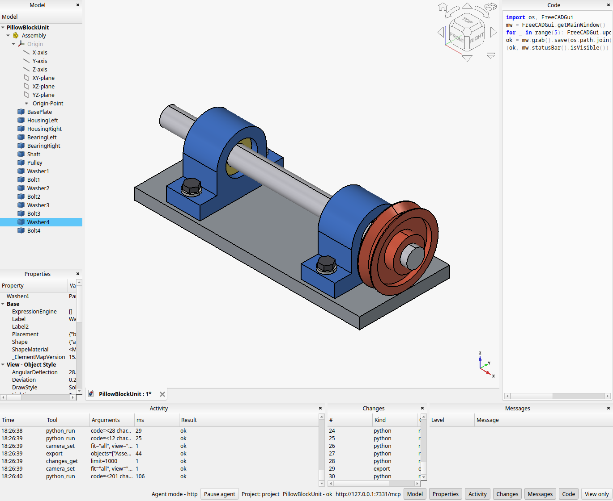

# agentic-freecad

A fork of FreeCAD that turns the application into a tool for agents: a Model
Context Protocol (MCP) server drives FreeCAD, and a viewer window shows a
person what the agent is doing. The design is in `DESIGN.md` at the root of
the parent workspace; this folder documents what is built.



The viewer (`FreeCAD --agent`) after an agent built a 15-part pillow-block
shaft unit through the HTTP transport: the model tree and the properties of
the last part it touched on the left, the 3D view in the middle, the last
Python it ran on the right, its tool calls, change log and messages at the
bottom, and the status bar with Pause agent, the document state, the server
URL and the panel toggles. See `viewer.md`.

## Status: complete (server stages 0 to 9, viewer V0 to V4)

Stage 9 hardened the server and checked it end to end:

- the protocol never lets an exception escape into a transport (an
  unexpected one becomes a JSON-RPC internal error), and serialises
  responses replacing invalid UTF-8 instead of throwing; a fuzz test sends
  random bytes, random request shapes, deep nesting and multi-megabyte
  strings;
- the stdio transport keeps a private duplicate of stdout and points
  descriptor 1 at stderr, so stray output (a `print` in the console binary,
  an addon, a library) cannot corrupt it;
- `python_run` keeps at most 256 KiB of stdout and of stderr, the end of
  the output, and says how much it dropped;
- `selection_get` reports plain element names (`Face1`) for shapes with a
  topological-naming element map, with the mapped names beside them;
- `workbench_activate` returns the dialogs it answered;
- opening a project opens its `mainDocument`; the unused `scriptsFolder`
  setting is gone;
- `tests/agentic/mcp_client.py` (a stdlib MCP client) and
  `tests/agentic/e2e.py` (one scenario through every tool group) run over
  stdio with `FreeCAD` and `FreeCADCmd`, over HTTP, and against the viewer;
- `doc/agentic/parity.md`, generated by `tests/agentic/parity_audit.py`,
  maps every menu and toolbar command of every workbench to the agent's
  route; `doc/agentic/client-setup.md` explains connecting clients and
  containing the agent.

The viewer series is described in `viewer.md`.

## Stage 8

Stage 8 added documentation:

- the Python API index is generated at build time from the `.pyi` binding
  stubs (`make_api_index.py`, stdlib only, a custom command of the
  module's CMake) into `Mod/Agentic/api_index.json`: every class with its
  members, signatures (all overloads), documentation and deprecations,
  and every module-level function; classes carry their Python name, and
  Base types their `FreeCAD.` alias;
- `docs_api` looks up a class, a member or a function (`Part.Shape`,
  `Part.Shape.makeFillet`, `App.Vector`, the C++ class name);
  `docs_command` documents a GUI command; `docs_page` fetches a wiki page
  as Markdown from FreeCAD-documentation (the source the Help module
  reads) and caches it under `AGENTIC_FREECAD_DOCS_CACHE` or
  `$XDG_CACHE_HOME/agentic-freecad/wiki`; `docs_update` prefetches pages
  or the whole archive; `docs_status`;
- `docs_search` ranks hits across the API, the commands, the cached wiki
  pages and installed addons' READMEs;
- resources: `agentic://docs/api/{name}` and `agentic://wiki/{page}`
  (resource templates, now supported by the protocol),
  `agentic://project/changes`, `agentic://project/log`; prompt:
  `freecad-object-model`.

## Stage 7

Stage 7 added addons:

- the catalog is the Addon Manager's (FreeCAD/Addons `Data/Index.json`:
  addon id to entries with repository, branch, archive URL and FreeCAD
  version range), merged with the user's registries (preference
  `BaseApp/Preferences/Mod/Agentic/Registries`) and the project's
  (`registries` in `.freecad-project.json`); remote registries are fetched
  over TLS and cached for a day under `$XDG_CACHE_HOME/agentic-freecad`
  (or `AGENTIC_FREECAD_CACHE`); `UseDefaultRegistry` turns the FreeCAD
  index off;
- `addon_install` downloads the archive over TLS (or runs `git clone`
  without a shell), extracts it refusing absolute paths, `..` and links,
  installs into `<project>/<addonFolder>/<id>` with a manifest, and loads
  it into the session as FreeCAD's startup does (folder on `sys.path`,
  `Init.py`, and `InitGui.py` when the GUI is loaded, so its workbenches
  appear); installed addons are loaded again when the project opens;
  Python dependencies from `package.xml` are reported, not installed;
- `addon_catalog`, `addon_installed`, `addon_remove`, `addon_files` (list or
  read an addon's files: README, macros, parts), `addon_registry_list`,
  `addon_registry_add` (project or user scope).

Installing an addon runs its code: that is what an addon is. Removing one
deletes its folder, but code it loaded stays registered until FreeCAD
restarts.

## Stage 6b

Stage 6b added edit mode and structured sketching:

- `object_edit` enters an object's edit mode as a double-click in the
  tree does (a sketch opens in the editor, a feature its task panel, mode
  1 the transform dialog) and returns the task panel that opened;
  `object_edit_end` leaves it and recomputes;
- sketch tools over the Sketcher API, in sketch-plane coordinates (mm,
  degrees), all in the App layer: `sketch_get` (geometry and constraints
  with 0-based indices and the solver's diagnosis: solved, degrees of
  freedom, fully constrained, conflicting, redundant and malformed
  constraints, open vertices, closed wires), `sketch_add` (line, circle,
  arc, point, ellipse, B-spline, polyline and rectangle with their
  implied constraints, construction flag), `sketch_constrain` (every
  constraint type by element references such as `[3, "start"]`,
  `"origin"`, `"xAxis"`, with values as numbers or strings with units,
  names and reference dimensions; Lock as two distances from the origin),
  `sketch_remove`, `sketch_solve`;
- each mutating sketch call is one transaction and records its Python.

The Sketcher numbers its conflicting and redundant lists from 1; the tools
convert them to 0-based indices so they can be passed to `sketch_remove`.

## Stage 6

Stage 6 added geometry facts, sub-element discovery, import, export, the
camera, captures and drawings:

- App tools (also in `FreeCADCmd`): `geometry_info` (volume, area,
  bounding box, center of mass, element counts, validity, closedness; by
  default for the document's result shapes, the ones no other shape
  consumes), `geometry_check` (OpenCASCADE's checker with the boolean
  check), `shape_elements` (faces, edges and vertices with names and
  geometry, filtered by surface or curve type, by a direction with the
  modes `extreme`, `facing` and `sort`, or ordered by distance from a
  point: the agent's replacement for clicking a face), `file_formats`,
  `import` and `export` through FreeCAD's registered importers and
  exporters for the extension, preferring the GUI variants that keep
  colours when the GUI is loaded;
- GUI tools: `camera_get`, `camera_set` (named orientations, a direction,
  an orientation, an Inventor camera string, the camera type, fit to all,
  the selection or listed objects), `view_options` (axis and corner cross,
  camera type, background, draw style), `view_capture` (offscreen PNG
  returned as MCP image content and kept in the project; a capture with
  its own view restores the session camera afterwards; `objects` shows
  only those), `drawing_export` (TechDraw page to SVG or PDF);
- tool results can carry images, which the protocol sends as `image`
  content items.

TechDraw's PDF printer dereferences the page's graphics scene without a
check, and that scene exists only once the page is shown in its drawing
view; `drawing_export` opens the page view before printing.

## Stage 5

Stage 5 added GUI commands, task panels, modal dialogs and selection
(registered only when the GUI layer is loaded, so `FreeCADCmd` lacks them):

- `workbench_list`, `workbench_activate`, `command_list` (all commands, or a
  workbench's toolbar commands with their toolbar names, filterable),
  `command_info`;
- `command_run` runs a command as its toolbar button would: the macro
  recorder captures the Python it issues, the object tracker records what
  it created, changed or deleted, and a task panel it opened is described;
  an inactive command is refused with the reason;
- task panels: `task_get` lists the open panel's visible input fields (id,
  kind, label, value, options, tooltip), `task_set` fills them through the
  widgets' own API so the panel reacts as to a person (combo boxes also
  emit `activated`), `task_accept` and `task_reject` press OK or Cancel;
- modal dialogs: while a tool runs (and always in agent mode) a modal
  dialog is answered on the next event-loop turn, a message box with its
  default button, else its escape button, else the button that declines;
  file dialogs and other dialogs are rejected; the answers are returned
  with the tool result under `dialogs`, so no command can block the server;
- `selection_get`, `selection_set` (objects and sub-elements, replace or
  add), `selection_clear`.

Command activity is tested the way the classic GUI does it, after the
command's action exists: calling `isActive()` earlier crashes some upstream
commands (`Std_Expressions` dereferences its action there).

Stage 4 added Python execution:

- `python_run` runs a code string or a project file inside FreeCAD. The
  namespace persists per project between runs (`python_reset` forgets it)
  and has `FreeCAD`/`App`, `FreeCADGui`/`Gui` when present, `Part`, `doc`
  (the active document) and `project_root` bound;
- the result carries the value of a trailing expression, stdout and
  stderr, the exception with its traceback, the objects the run created,
  changed and deleted (tracked through the application's object signals),
  the documents saved afterwards (documents a script creates inside the
  project are adopted), and the console messages;
- the run is one transaction on the active document: committed on
  success, rolled back on an exception, and reported when the script
  closed it itself; `timeoutSeconds` (default 60) stops Python code through
  a trace hook, which cannot interrupt a recompute running inside C++.

Stage 3 added documents, objects, properties and preferences:

- documents of a project: `document_list`, `document_open`, `document_new`,
  `document_save`, `document_close`, `document_recompute`, `document_undo`,
  `document_redo`; with `autoSave` a document is written to its `.FCStd`
  after every mutating call, so the folder is always the truth;
- objects: `object_list`, `object_get`, `object_set`, `object_create`,
  `object_delete`, `object_dependencies`; every mutation is one transaction
  named after the tool, so `document_undo` reverses exactly one call;
  `autoRecompute` recomputes afterwards and the result carries the objects
  in error, their status strings and the console messages of the call;
- properties cross to and from JSON through `agentic_props.py`, the same
  Python API a script would use: quantities with units, vectors,
  placements, rotations, links and sub-element links, enumerations with
  their options, colours, expressions (`{expression: ...}`); view-provider
  properties (appearance, transparency, line width, display mode,
  visibility) are read under `view` and set the same way when the GUI
  layer is present; `object_create` imports the module of an unknown type
  (`Part::Box` loads `Part`);
- preferences: `preferences_get` and `preferences_set` over the parameter
  tree behind the Preferences dialog, typed values, removal with `null`.

Stage 2 added projects, files and the session layer:

- a project is a folder with `.freecad-project.json` (name, main document,
  addon folder, `autoSave`, `autoRecompute`, registries),
  created on first `project_open`; `--project DIR` opens one at start;
  several projects can be open, the one the last tool call addressed is
  current;
- the file sandbox: every path resolves under the project root with
  symlinks followed, writes are atomic and versioned by content hash,
  `baseVersion` detects concurrent changes, exact-text edits must match
  once, hidden entries are skipped;
- the message log (every console message, sequence-numbered, thread-safe)
  and the per-project change log (every mutation, with the equivalent
  Python where there is one);
- `SessionObserver`, the event interface the viewer will implement, and
  tool-call timing delivered to it;
- tools: `project_open`, `project_list`, `project_info`, `project_set`,
  `file_list`, `file_read`, `file_write`, `file_rename`, `file_delete`,
  `log_get`, `changes_get`.

Stage 1 completed the protocol and transports on top of the stage 0 skeleton:

- tool arguments are validated against each tool's `inputSchema` (type,
  required, enum, bounds, array items, nested objects, unknown properties)
  before the handler runs; a violation is a `-32602` error naming the path;
- resources (`resources/list`, `resources/read`) and prompts
  (`prompts/list`, `prompts/get`), with `agentic://status` and the
  `agentic-loop` prompt; the `initialize` response carries the loop as its
  instructions;
- the HTTP transport (`--agent`, `--agent-port N`): MCP Streamable HTTP
  without the SSE stream, POST `/mcp` on `127.0.0.1`, a per-start bearer
  token printed on stderr together with the `claude mcp add` line, foreign
  `Origin` headers refused, notifications answered with 202;
- `FreeCADCmd --agent-stdio`: the console binary serves too, through an
  internal script that runs a `QCoreApplication` loop; view tools report
  `gui: false` there;
- `doc/agentic/tools.md`, generated from the live registry by
  `src/Mod/Agentic/tools_reference.py`.

Stage 0 is the skeleton that the rest is built on:

- the `Agentic` module (`src/Mod/Agentic`), enabled by `BUILD_AGENTIC`;
- the command-line options `--agent`, `--agent-stdio`, `--agent-port`,
  `--agent-headless`, `--project`;
- a JSON-RPC 2.0 / MCP protocol layer with `initialize`, `ping`,
  `tools/list`, `tools/call`, and two tools, `version` and `status`;
- the stdio transport (`--agent-stdio`): one JSON message per line, requests
  executed on the main thread one at a time, the process exits when stdin
  closes;
- the viewer shell: in agent mode the main window loses its menu bar,
  toolbars and upstream dock windows and gains an Activity panel showing the
  request and response stream;
- tests: `Agentic_tests_run` (GoogleTest), `TestAgenticApp` and
  `TestAgenticGui` (FreeCAD unittest suites), and
  `tests/agentic/stdio_smoke.py` (end-to-end client).

The HTTP transport, projects, files, documents, Python execution, views,
captures, export, addons and documentation tools follow in the stages of
`PLAN.md`.

## Running

```bash
pixi run configure && pixi run build

# headless server for an MCP client (Claude Code shown)
claude mcp add freecad -- env QT_QPA_PLATFORM=offscreen \
    $PWD/build/relWithDebInfo/bin/FreeCAD --agent-stdio

# the same, by hand
printf '%s\n' '{"jsonrpc":"2.0","id":1,"method":"initialize","params":{}}' \
  | QT_QPA_PLATFORM=offscreen build/relWithDebInfo/bin/FreeCAD --agent-stdio

# HTTP transport: prints the endpoint, the token and the `claude mcp add` line on stderr
build/relWithDebInfo/bin/FreeCAD --agent                     # viewer window, ephemeral port
build/relWithDebInfo/bin/FreeCAD --agent --agent-port 7331   # fixed port
QT_QPA_PLATFORM=offscreen build/relWithDebInfo/bin/FreeCAD --agent --agent-headless --agent-port 7331

# the console binary serves stdio too (no view tools)
build/relWithDebInfo/bin/FreeCADCmd --agent-stdio

# the untouched upstream GUI
build/relWithDebInfo/bin/FreeCAD
```

## Tests

```bash
build/relWithDebInfo/tests/Agentic_tests_run
build/relWithDebInfo/bin/FreeCADCmd -t TestAgenticApp
xvfb-run build/relWithDebInfo/bin/FreeCAD -t TestAgenticGui
QT_QPA_PLATFORM=offscreen build/relWithDebInfo/bin/FreeCAD -t TestAgenticGui
python3 tests/agentic/stdio_smoke.py build/relWithDebInfo/bin/FreeCAD
python3 tests/agentic/stdio_smoke.py build/relWithDebInfo/bin/FreeCADCmd
python3 tests/agentic/http_smoke.py build/relWithDebInfo/bin/FreeCAD
QT_QPA_PLATFORM=offscreen build/relWithDebInfo/bin/FreeCAD tests/agentic/make_tools_reference.py   # regenerates tools.md
```

See `upstream-merge.md` for the list of upstream files the fork edits.
